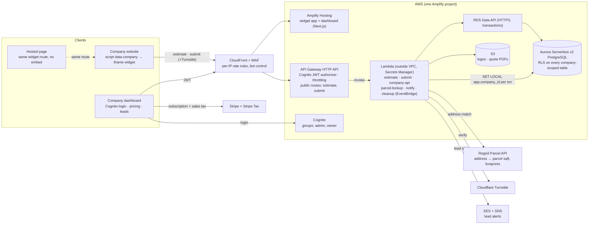
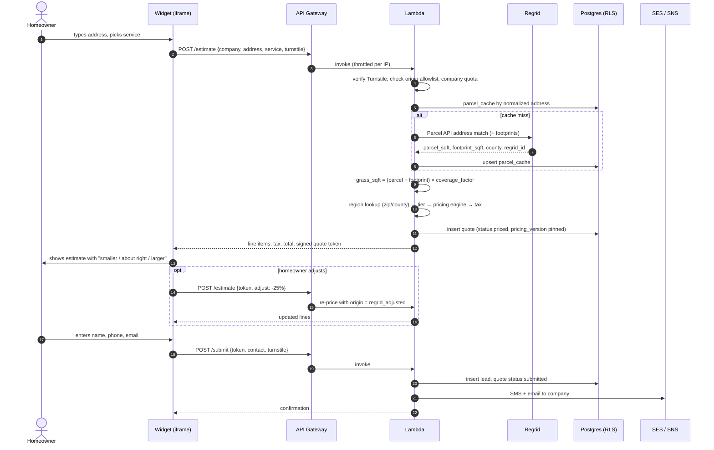
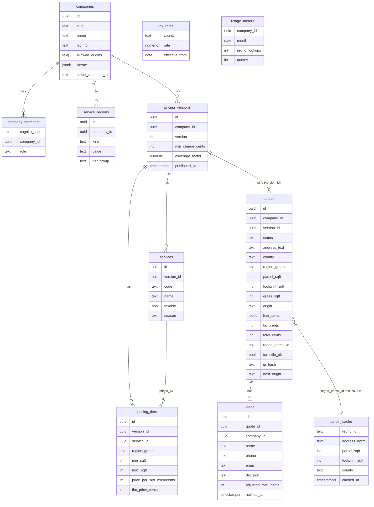

# Quote Platform Engineering Design

Rev 2.4 · 2026-10-10 · Companion: `COMPLIANCE_REQUIREMENTS.md` (R1–R31) · Scope: MVP for Pennsylvania design partners

A web application and single-line embeddable widget on AWS Amplify. The homeowner outlines the lawn on an aerial photo of the address (Mapbox), a pure pricing function applies the company's own rate table, PostgreSQL with Row Level Security enforces tenancy, and Cognito handles company and admin login. Regrid, the parcel lookup of revisions up to 2.3, is retired on cost ("Property source" in the Decisions table). Sections 3, 5, 9 and 10 still describe the Regrid call where they have not been rewritten; where they differ from section 6 or the Decisions table, those win.

## 1. How the spec maps onto this design

| Spec item | Design | Carried from planning | Adjustment |
| --- | --- | --- | --- |
| Lawn estimate calculator: address → Regrid boundaries and sqft → grass estimate × regional price per sqft | Measurement without a map: parcel sqft − building footprint sqft × a company-set coverage factor; regional tiers by zip or county | Rules-only pricing, versioned rate tables, per-line tax, estimate disclaimer, Regrid cache rules | **Add** minimum charge, a one-tap "smaller / about right / larger" adjustment, and a manual lot-size fallback for addresses Regrid cannot match |
| Single-line embeddable widget with `company_id` | A `<script>` that injects an iframe; the same route also serves as a hosted page | Turnstile, per-IP and per-company rate limits, Regrid circuit breaker | **Add** a per-company allowed-origins list enforced with `frame-ancestors` and an origin check in the API |
| PostgreSQL with RLS for company profiles, regions, tiers, leads | Aurora Serverless v2 PostgreSQL via the RDS Data API; RLS keyed on a per-transaction session variable set from the Cognito token | Schema shape, the no-foreign-key rule for `parcel_cache`, versioned pricing | **Add** `FORCE ROW LEVEL SECURITY` and a non-owner application role, or RLS silently does nothing |
| AWS Amplify hosting and CI/CD; Cognito for admin and company login | Amplify Hosting for both front ends; Cognito user pool with `admin` and `owner` groups; API Gateway JWT authorizer | Passwordless sign-in available through Cognito | **Add** lead alerts (SES + SNS), which the spec omits and without which there is nothing to sell |

## 2. Constraints the design treats as fixed

- **Pricing is rules only.** Price = the company's published pricing version applied to an estimated grass area. No model, no learned parameters, no cross-tenant data. (R20)
- **Nothing from Mapbox is stored.** The address's position aims the photo in the browser and goes no further; the outline is measured there and only its area is sent. Quotes own their numbers. (R12, R16) The Regrid cache (`parcel_cache`) is dormant and stays deletable. (R10)
- **The widget runs on sites we don't control.** Anonymous traffic, arbitrary host pages, no cookies we can rely on. Every write goes through a Lambda with Turnstile and rate limits.
- **Tax is per line.** Every service carries a taxable flag; quotes store line items; tax applies to the taxable subtotal at the county rate. (R1–R4)
- **Tenancy is enforced in the database.** RLS on every company-scoped table, so a bug in a Lambda cannot leak one company's leads to another.
- **The lawn area is drawn, not computed.** The homeowner outlines the lawn on a static satellite photo; there is no map library. The lot-size form is always offered beside it.

## 3. System architecture on AWS

Two front ends on Amplify Hosting, one HTTP API behind CloudFront + WAF, a handful of Lambdas, one Postgres. Lambdas stay outside the VPC and reach Postgres through the RDS Data API over HTTPS, which avoids a NAT Gateway (~$32/month) for outbound Regrid and Turnstile calls.



Both clients enter through CloudFront and API Gateway. The widget's routes are public, protected by Turnstile, WAF and throttling; the dashboard's routes require a Cognito JWT. Lambdas hold the secrets and are the only thing that talks to Regrid, Turnstile, the notifiers and the database. The Next.js apps are shells with no business logic.

If Amplify Gen 2's `defineData` with a SQL data source is preferred over hand-written Lambdas, authorization moves to AppSync owner rules and Postgres RLS becomes a second line of defense rather than the mechanism. This design keeps RLS as the mechanism because the spec names it and because it protects against Lambda bugs, not only against missing auth rules.

## 4. Embeddable widget

One script tag. The script injects an iframe pointed at our domain, so the widget's CSS and JS never collide with the host page, the host page cannot read the lead form, and a CSP on our side decides who may embed it.

```html
<script src="https://widget.example.com/v1.js" data-company="joes-lawn" async></script>
```

`v1.js` (≈ 2 KB, served from Amplify Hosting with long cache headers):

1. Reads `data-company`, creates `<iframe src="https://w.example.com/w/joes-lawn" title="Instant lawn quote" style="width:100%;border:0" loading="lazy">`.
2. Listens for `postMessage {type:"lq:resize", height}` from `w.example.com` only and sets the iframe height.
3. Relays `{type:"lq:submitted"}` to `window.dataLayer` if present (host analytics).
4. Never reads or writes anything else on the host page.

`/w/[company]` (the widget app, also the hosted page):

- Server-renders the company's public profile (name, logo, color, services, regions).
- Response header `Content-Security-Policy: frame-ancestors 'self' https://joeslawn.com https://www.joeslawn.com`, built from `companies.allowed_origins`; empty list = `'self'` only (hosted page works, embed does not).
- The page sends `document.referrer` / `location.ancestorOrigins` with every API call; the API rejects calls whose origin is not in the company's allowed list.

Rules:

- `company_id` is public. Nothing sensitive is keyed on knowing it: rates never reach the browser, and quota abuse is blocked by the origin allowlist plus Turnstile.
- The hosted page is the same route without an embedding parent; add a QR code generator in the dashboard for operators with no website.
- No reliance on third-party cookies. The iframe keeps state in memory and in a signed quote token returned by the estimate call.
- Turnstile works inside an iframe; the widget key is scoped to `w.example.com`.
- Theming is a logo, a primary color and a service list from the public profile, applied as CSS variables at render time and contrast-checked (see §11). No per-company CSS upload.

## 5. Estimate and lead flow

Two public calls. The first returns a price without requiring contact details; the second captures the lead and carries a signed token for the first, so the price shown is the price submitted.



| State | Set by | Meaning | Retention |
| --- | --- | --- | --- |
| `priced` | /estimate | Line items, tax and total from a pinned pricing version | Deleted after 7 days if never submitted (EventBridge nightly) |
| `submitted` | /submit | Contact captured, lead row exists, company notified | Expires after 30 days unless acted on |
| `accepted` / `declined` | Company, in the dashboard | Operator's decision with optional adjusted total | 12 months |
| `expired` | Scheduled job | No action within 30 days | 12 months |

## 6. Grass estimate

```text
address         typed by the homeowner; found with Mapbox geocoding, in the browser (types=address, US)
photo           Mapbox static satellite image around that position; zoom 16 to 20, moved in steps
outline         corners placed by tap, click or keyboard; several areas allowed (front and back yard)
area            measured in the browser from the corners' positions on the ground
grass_sqft      = round100(area)        // no coverage factor: the outline is the lawn; origin = drawn
zip             the one in the typed address, or asked for on the photo screen; decides the tax county
fallback        address not found, photo no use, or the homeowner's choice: lot-size bucket or typed sqft
```

| Condition | Behavior |
| --- | --- |
| Mapbox finds no street address, or cannot be reached | The lot-size form, saying the address was not found on the map |
| The photo does not load | An alert on the photo screen; the lot-size form is one button away |
| No Mapbox token configured | No photo screen: the address goes to `/estimate` as before and the lot-size form follows |
| Outline under 100 or over 2,000,000 sq ft | Refused on the photo screen, and by the contract |
| Zip spans counties with different rates | The county question, then back to the photo with the outline kept |

The area is the homeowner's own figure, as a typed area already was: the server prices what it is sent and records `origin = drawn`, which the company sees on the lead. Imagery can be years old and trees hide lawn, so the quote says "measured on an aerial photo, not a survey" and the company confirms the price (R6).

### Retired: the parcel formula

Kept for the record and for quotes already priced this way. No environment has a Regrid token, so this path does not run.

```text
parcel_sqft     from Regrid (ll_gissqft or equivalent; fall back to acres × 43,560)
footprint_sqft  from Regrid matched building footprints add-on (0 if not licensed)
coverage_factor company-set per region, default 0.70   // share of non-building lot that is mowed lawn
grass_sqft      = round100( max(0, parcel_sqft − footprint_sqft) × coverage_factor )
adjust          homeowner taps "smaller" (×0.75) or "larger" (×1.25), once; origin = regrid_adjusted
fallback        no parcel match → lot-size bucket (¼, ½, 1, 2+ acres) or typed sqft; origin = bucket | manual
```

| Condition | Behavior |
| --- | --- |
| Regrid finds no parcel, or more than one candidate | Show the manual path immediately; never guess from the typeahead point alone |
| Parcel over 2 acres | Skip the formula; ask for the mowed-area bucket |
| No footprint data for the parcel | Apply the coverage factor to the whole parcel minus 0.10; show "includes the house footprint" in the assumptions line |
| Address outside every service region | Refuse before any Regrid call; show the company's phone number |
| Homeowner adjusts | Allowed once; original estimate and adjustment both stored and shown to the company on the lead |

Expect the formula to be within ±25% of the real mowed area on typical suburban lots and worse on wooded, sloped or heavily paved ones. Show the estimated sqft and assumptions on the quote screen, label it an estimate (R6), and log the company's accepted total against the estimate so the error rate is known before deciding whether the P2 map editor is worth building.

## 7. Data model and Row Level Security

Eleven tables, all company-scoped ones under RLS. Pricing is versioned: a company edits a draft, publishes it, and every quote pins the version that priced it. `parcel_cache` is referenced by text id only.



Notes: `admin` is a Cognito group, not a row. `tax_rates` is looked up by `quotes.county` at pricing time (PA seed: 6%, Allegheny 7%, Philadelphia 8%). `usage_meters` alerts at 8,000 Regrid lookups a month (R13). `parcel_cache` is truncatable at any time; nothing references it.

### RLS

| Table | anon (public routes) | authenticated owner | service role (Lambdas) |
| --- | --- | --- | --- |
| companies | read via `public_company_profile` view only (name, slug, logo, services, regions) | select/update where member of company | all |
| pricing_versions, pricing_tiers, services | none (rates never reach the browser) | select/insert where company is theirs; no update after `published_at` | read for pricing |
| quotes, leads | none | select/update where `company_id` is theirs | insert/update from estimate and submit |
| parcel_cache, tax_rates, usage_meters | none | none (usage shown through a view) | all |

Pattern and the two gotchas:

```sql
-- every company-scoped table
ALTER TABLE leads ENABLE ROW LEVEL SECURITY;
ALTER TABLE leads FORCE ROW LEVEL SECURITY;         -- gotcha 1: the table owner bypasses RLS without this
CREATE POLICY leads_company ON leads
  USING (company_id = current_setting('app.company_id', true)::uuid);

-- the Lambda, per request, inside one Data API transaction
BEGIN;
SET LOCAL app.company_id = '…';                      -- resolved server-side from company_members by Cognito sub
SELECT … FROM leads …;                               -- the policy filters automatically
COMMIT;

-- roles
-- app_rw     non-superuser, NOT the table owner, used by the Lambdas   -- gotcha 2: superusers ignore RLS entirely
-- app_public same, GRANTed only EXECUTE on the estimate/submit functions and SELECT on public_company_profile
-- admin      Cognito group → Lambda sets app.company_id to the requested company after checking the group claim
```

- Put the two lines in one shared `withCompany(token, fn)` helper; nothing else opens a connection.
- Public estimate and submit routes run with no company session; they write through `SECURITY DEFINER` functions that take the company slug and validate it.
- Add a test that runs the suite as `app_rw` with the wrong `app.company_id` and asserts zero rows.

## 8. Pricing engine

A pure function in `packages/pricing`, run only in the estimate Lambda and in the dashboard's "preview a quote" screen. Regional tiers replace per-mile travel cost: a region is in or out, and its tier group carries any distance premium.

```ts
type PricingInput = {
  version: PricingVersion          // published, fully loaded: tiers, services, min_charge
  serviceCode: string              // "mow", "mow_edge", "snow_push" …
  grassSqft: number                // from the estimate step, rounded to 100
  regionGroup: string              // from service_regions for this zip/county, e.g. "core" | "outer"
  taxRateBps: number               // tax_rates by county, in basis points: 6% is 600
}
// steps
// 1. tier    = version.tiers.find(t => t.service === serviceCode
//                                   && t.regionGroup === regionGroup
//                                   && grassSqft > t.minSqft && grassSqft <= t.maxSqft)
//              none → "no price for this size; call us"
// 2. labor   = tier.pricePerSqft ? grassSqft × tier.pricePerSqft : tier.flatPrice
// 3. base    = max(version.minCharge, labor)
// 4. lines   = [{ service, base, taxable: service.taxable }] + add-ons as separate lines (R3)
// 5. tax     = roundHalfUp(Σ taxable lines × taxRateBps / 10,000), in whole cents
// 6. total   = Σ lines + tax
// 7. return  { lines, subtotal, taxableSubtotal, taxRateBps, tax, total, versionId }
```

Worked example, 11,200 sqft parcel in State College, mowing:

| Step | Input | Computation | Result |
| --- | --- | --- | --- |
| Footprint | Regrid: house 2,100 sqft | 11,200 − 2,100 | 9,100 sqft |
| Coverage | company default 0.70 | 9,100 × 0.70 → round100 | 6,400 sqft |
| Region | 16801 → "core" | tier: core · mow · 5,001–10,000 | $0.0075/sqft |
| Labor | | 6,400 × 0.0075 | $48.00 |
| Minimum charge | $45.00 | max(45.00, 48.00) | $48.00 |
| Tax | mowing taxable; Centre County 6% (`taxRateBps` 600) | 4,800 cents × 600 / 10,000 | $2.88 |
| Total | | 48.00 + 2.88 | $50.88 |

Frequency discounts and complexity multipliers are optional fields on the pricing version, added when a design partner asks, without changing the function's shape. Money is integer cents everywhere except display.

## 9. Public routes and abuse controls

Four layers, cheapest first:

- **CloudFront + WAF** in front of widget and API: per-IP rate-based rule (100 requests per 5 minutes), AWS managed bot-control ruleset. (HTTP API Gateway has no per-client throttling and WAF cannot attach to it directly.)
- **API Gateway throttling** on public routes: burst 20, 10 rps per route.
- **Turnstile** on every estimate and submit call, verified in the Lambda before any Regrid call or lead insert.
- **Origin allowlist**: the Lambda compares the reported embedding origin to `companies.allowed_origins`; mismatches refused and counted.
- **Quotas and the circuit breaker**: per-company monthly quota in `usage_meters` with alerts at 80%; global cap of 8,000 Regrid lookups a month, after which estimates fall back to the manual path and CloudWatch pages us (R13).
- **Lead spam**: honeypot field, phone/email validation, per-company daily dedupe, per-company SMS cap (30/day, then digest email); SNS account spend limit and an AWS Budgets alarm.
- **Trial abuse**: new companies get zero estimate quota until a Stripe subscription or approved trial is active.
- **Secrets**: Regrid, Turnstile, Stripe, SES, SNS credentials in Secrets Manager, read once per cold start.
- **Hygiene**: unsubmitted quotes deleted at 7 days; IPs stored as salted hashes; Aurora backups 7 days with a quarterly restore drill.

## 10. Threat model

| Threat | Current control | Gap and fix | Priority |
| --- | --- | --- | --- |
| Flood on public routes starving real users | API Gateway stage throttling | HTTP API throttling is not per client and WAF cannot attach to it. CloudFront in front of widget and API with WAF per-IP rules and bot control. | high |
| Lead spam → SMS to companies at 3 a.m. → churn | Signed quote token on /submit | Turnstile on /submit, honeypot, validation, per-company daily dedupe, SMS cap 30/day then digest. SNS spend limit + Budgets alarm. | high |
| Trial abuse: sign up, burn Regrid quota | Per-company quota | Zero quota until subscription or approved trial; trials hard-capped. | high |
| XSS via company theming on our origin | None | Widget on `w.`, dashboard on `app.`; hex regex for color; logos only from our S3 via presigned upload; name escaped; widget CSP with no inline script. | high |
| Tenant escalation through a self-set Cognito attribute | RLS on `app.company_id` | Resolve `company_id` from `company_members` by `sub` server-side (or pre-token Lambda reading the DB); never from a user-writable attribute. MFA for the admin group. | high |
| Competitor embeds a company's widget to drain its quota | Origin allowlist + `frame-ancestors` | Allowlist is browser-enforced only; Turnstile is the real cost to attackers. Accept the residual. | medium |
| Price scraping to reverse-engineer tiers | Rate limits, Turnstile, tiers never returned | Inherent to instant quotes. Accept and disclose to operators. | medium |
| Public Lambdas exhaust account concurrency | None | Reserved concurrency on estimate and submit; cap Aurora max ACU; alarm on throttles. | medium |
| Supply chain: `v1.js` runs on every customer site | Served from Amplify | Tiny, no `eval`; branch protection and 2FA on GitHub and AWS; least-privilege Amplify role; pinned versions with SRI on request. | medium |
| PII in logs | None | Log quote ids only; redact addresses, phones, emails. Private S3 with short-lived presigned URLs. | medium |
| Clickjacking, CSRF, user enumeration on the dashboard | JWT in Authorization header | `frame-ancestors 'none'` on the dashboard; Cognito "prevent user existence errors"; no cookie auth. | low |
| Forged Stripe webhooks or client-claimed plan status | None | Verify webhook signatures; plan status only from webhook-updated rows; idempotency keys. | low |
| Dependency outage (Turnstile, Regrid) | Circuit breaker on Regrid | Either down → manual path, no Regrid spend, widget stays usable. | low |

## 11. Accessibility (WCAG 2.2 AA)

### Widget

| Criterion | Where it bites | Design rule |
| --- | --- | --- |
| 4.1.2 Name, role, value · 2.1.1 Keyboard | Address typeahead | WAI-ARIA combobox: `role="combobox"`, `aria-expanded`, `aria-controls`, `aria-activedescendant`; arrows, Escape, Enter; result count in `aria-live`. Test with VoiceOver on iOS. |
| 1.4.3 Contrast · 1.4.11 Non-text contrast | Company brand color | Contrast computed at render time; brand color on buttons only when it passes 4.5:1 with its text, otherwise as border/accent with text from a fixed safe palette. Companies never set text color. |
| 4.1.3 Status messages | Price returned, adjust chips, errors | `aria-live="polite"` on the price region; `role="alert"` for errors; error summary linked with `aria-describedby`. |
| 1.3.5 Input purpose · 3.3.7 Redundant entry | Lead form | `autocomplete="name|tel|email|street-address"`; address never asked twice. |
| 2.5.8 Target size | Adjust chips, service picker | 44×44 CSS px on touch; 24×24 is the floor. |
| 1.4.10 Reflow · 1.4.4 Resize text | Widget inside a host page | Works at 320 px; `ResizeObserver` re-sends iframe height after 200% zoom. |
| 2.4.7 Focus visible · 2.4.11 Focus not obscured | Host page sticky headers | Visible focus ring; on focus the widget posts a scroll-into-view request. |
| 3.3.8 Accessible authentication | Dashboard login | Cognito passwordless email link or password + TOTP; no puzzles. Turnstile has no visual puzzle; do not add reCAPTCHA. |
| 2.5.7 Dragging movements | P2 map editor | Vertex drag needs a non-drag alternative; the manual path is it. |
| H64 · 3.1.1 | Iframe, document | `title="Instant lawn quote from <company>"` on the iframe; `lang`; `prefers-reduced-motion` respected. |

### Dashboard

| Screen or control | Criteria | Build rule |
| --- | --- | --- |
| Lead inbox table | 1.3.1 · 2.1.1 · 1.4.1 | Real `<table>` with `<th scope>`; sortable headers as buttons with `aria-sort`; row actions reachable by Tab; status as text plus shape, never color alone; pagination as links with current page announced. |
| Pricing version editor | 3.3.1 · 3.3.2 · 3.3.3 · 1.3.5 | Visible labels with units ("$ per 1,000 sq ft"); inline errors linked with `aria-describedby` and a focusable error summary; tier rows reorder with move-up/move-down buttons, not drag only. |
| Publish pricing | 3.3.4 Error prevention (legal, financial) | Two-step confirm with a diff against the current version and a rollback (re-publish previous). |
| CSV import | 1.3.1 · 4.1.3 | Native file input with label; progress in `aria-live`; errors returned as a table (row, column, problem), focusable and announced. |
| Dialogs and toasts | 2.4.3 · 2.1.2 · 4.1.3 | Native `<dialog>` or library dialog: focus in on open, Escape closes, focus returns to trigger. Toasts `aria-live="polite"`, ≥ 5 s, never the only copy of a result. |
| Navigation and routing | 2.4.1 · 2.4.2 · 3.2.3 · 3.2.6 | Skip link; landmarks; on route change set `document.title` and move focus to `h1`; help in the same place on every screen. |
| Login and session | 3.3.8 · 2.2.1 · 3.3.7 | Passwordless email or password + TOTP; password managers not blocked. Silent token refresh while active; 2-minute warning before forced sign-out with form state preserved. |
| Analytics charts | 1.1.1 · 1.4.11 | Text summary and "view as table" toggle; series distinguished by shape or label; colors from the token set. |
| Status chips | 1.4.1 · 1.4.3 | Chips carry text; chip colors are tokens passing 4.5:1 in light and dark. |
| Responsive and zoom | 1.4.10 · 1.4.4 · 1.4.12 | Tables scroll inside their own container at 320 px; usable at 200% zoom; no fixed heights that clip text. |
| Forced colors and motion | 1.4.11 · 2.3.3 | Test Windows High Contrast (`forced-colors`): borders on controls. Respect `prefers-reduced-motion`. |

### Front-end standards

- Component library with the patterns built in: React Aria Components (combobox, table, dialog, listbox) or Radix primitives; widget and dashboard share it.
- Design tokens with contrast checked at build time; the company brand color applied through a render-time-checked token, never raw.
- `eslint-plugin-jsx-a11y`; Storybook with the axe addon; `@axe-core/playwright` on every route in CI failing on serious/critical; Lighthouse CI for the hosted page.
- Manual passes per release: keyboard-only through the widget and the dashboard's four core flows (sign in, edit and publish pricing, handle a lead, import CSV); VoiceOver on iOS for the widget; NVDA or VoiceOver on desktop for the dashboard; 200% zoom; forced colors.
- Definition of done on every front-end PR: labels and names present, keyboard operable, focus visible and managed, status announced, contrast from tokens, axe clean.

Legal: ADA Title III demand letters against business websites are routine, and an inaccessible widget exposes customers as well as us. Claim "designed to WCAG 2.2 AA" only after the three passes; expect a larger customer to ask for a VPAT eventually.

## 12. Deployment issues to settle before the design-partner month

| Issue | What goes wrong | Rule |
| --- | --- | --- |
| Host-site CSP | A customer's strict CSP blocks the script or frame; the widget silently fails | Install docs include exact `script-src` and `frame-src` values; dashboard has a "test my site" probe that reports which header blocked it |
| Site builders | Wix wraps custom code in its own sandboxed iframe (resize messages may not propagate); GoDaddy restricts custom code; Facebook and Google Business Profile cannot embed | Test Wix, Squarespace, WordPress before launch; everything else gets the hosted page link and a QR code |
| Email deliverability | SES lead alerts land in spam | SPF, DKIM, DMARC on the sending domain in week one; dedicated transactional subdomain |
| Caching contract | Stale company profiles after a publish, or an uncacheable script | `v1.js`: `max-age=3600, stale-while-revalidate` plus a versioned immutable path; company profile via ISR revalidated on publish; API responses `no-store` |
| Environments | Staging shares a pool or database with prod | Three Amplify branches (dev, staging, prod) with separate Cognito pools and databases; backward-compatible migrations |
| Cookies and analytics | Third-party analytics in the iframe sets cookies, triggers banner obligations, contradicts the privacy policy | No non-essential cookies; first-party server-side event logging (estimate started, priced, adjusted, submitted) |
| Core Web Vitals | Webfont flash, logo layout shift, heavy bundle on a slow phone | System font stack in the widget; logo with fixed dimensions; widget bundle under ~100 KB gzipped; SSR for first paint |
| Domains and TLS | Mixed origins, no HSTS | `widget.` (script), `w.` (iframe app), `app.` (dashboard), `api.`; ACM via Amplify; HSTS; CloudFront in front |
| Monitoring | Errors nobody sees; PII in error reports | Error tracking with source maps and PII scrubbing; CloudWatch alarms on 5xx rate, Lambda throttles, Regrid usage, SNS spend |

## 13. AWS specifics and cost at zero scale

| Component | Choice | Why, and idle cost |
| --- | --- | --- |
| Hosting and CI/CD | Amplify Hosting, two apps from one repo | Git push deploys; small build and bandwidth cost |
| Auth | Cognito user pool; groups `admin`, `owner`; membership resolved server-side | Free well past 10,000 MAU; passwordless email available |
| API | API Gateway HTTP API; JWT authorizer for dashboard routes; public routes throttled; CloudFront + WAF in front | Cents per month at MVP volume plus WAF's base fee |
| Compute | Lambda (Node 20, TypeScript) outside the VPC | Always-free tier covers 1M requests/month; no NAT Gateway |
| Database | Aurora Serverless v2 PostgreSQL with auto-pause to 0 ACU, via RDS Data API | Near zero idle, ~$0.06/hour active; PostGIS available for P2 |
| Scheduled jobs | EventBridge → cleanup Lambda nightly | Free |
| Notifications | SES email, SNS SMS (10DLC registration takes ~2 weeks) | Pennies; Resend + Twilio as drop-in alternative |
| Files | S3 for logos and quote PDFs | Negligible |

The same design on Supabase is about a week less plumbing (RLS, Auth and Edge Functions pre-wired, $0 free tier). AWS is the right call with credits, for the experience, or if VPC-only resources are expected later. AWS's free tier for new accounts is a six-month credit plan, so budget for Aurora and Amplify from month seven.

## 14. Build sequence

Each step is testable without the one after it.

1. Aurora + Data API, schema, RLS policies and roles, PA seeds (services with taxable flags, county tax rates). The wrong-company RLS test passes before anything else is written.
2. `packages/pricing` as a pure package with table-driven tests: every tier boundary, the minimum-charge edge, the separately-stated tax rule, the no-tier case.
3. Cognito pool, groups, server-side membership resolution, and the dashboard shell with the pricing-version editor (draft → publish with diff and rollback) and CSV import of tiers.
4. Estimate Lambda against the Regrid sandbox with the coverage formula, region lookup and manual fallback; then the submit Lambda and notifications (SES first, SNS when 10DLC clears).
5. The widget app at `/w/[company]`, built at 390 px, with the adjust chips and the assumptions line; then `v1.js` and the `frame-ancestors` header.
6. CloudFront + WAF, throttling, Turnstile on both routes, origin allowlist, usage metering, trial gating, Stripe Checkout and Customer Portal.
7. Playwright end-to-end against a seeded company, axe in CI, the manual accessibility passes, then the design-partner month.

## 15. Decisions and open questions

| Topic | Status | Position |
| --- | --- | --- |
| Embed mechanism | decided | Script tag that injects an iframe. A DOM-injected widget inherits host CSS and breaks; a bare iframe cannot auto-size. |
| No map in the MVP | decided | Keep `origin` and the sqft columns on quotes so the P2 editor writes the same rows; measure estimate error against accepted totals first. |
| Tenancy mechanism | decided | Postgres RLS keyed on a session variable, with `FORCE` and a non-owner role. AppSync owner rules are the alternative if Amplify Data is adopted. |
| Database access | decided | RDS Data API from Lambdas outside the VPC. Avoids NAT cost and VPC cold starts; transactions supported, which `SET LOCAL` needs. |
| Edge protection | decided | CloudFront + WAF in front of widget and API (HTTP API has no per-client throttling and no WAF attachment). |
| Hosted page | add | Same route, no cost; many small operators have no website. |
| Lead alerts | add | Not in the spec; without them the company never learns a lead exists. Start SNS 10DLC in week one. |
| Minimum charge and coverage factor | add | "Price per sqft × area" alone quotes $11 for a townhouse strip. Both company-set on the pricing version. |
| Component library | decided | React Aria Components (or Radix) for combobox, table, dialog; shared by widget and dashboard. |
| Footprint source | open | Regrid matched-footprints add-on vs coverage-factor-only. Decide after seeing the add-on's price. |
| Region granularity | open | Zip codes are what operators think in; counties key tax rates. Store both on the quote; define regions by zip. |
| SMS provider | open | SNS keeps it in AWS but needs 10DLC; Twilio is faster to start and also needs 10DLC. Email alerts ship first. |
| Map editor (MapLibre + Mapbox imagery) | P2 | Rev 1 design applies; brings back the imagery-tracing question (R15) and per-tile billing. |
| Drive-time pricing, snow product | P2 | Snow reuses the tiers with a `season` on the service and driveway sqft from footprints or a bucket. |
| `company_id` on `services` and `pricing_tiers` | decided (step 1) | Both carry `company_id` beside `version_id`, tied to the parent by composite foreign keys, so every company-scoped table uses the same RLS predicate and a child row cannot name another company's parent. |
| Cross-company reads under `FORCE` | decided (step 1) | A third role, `app_definer` (no login, not the table owner), owns `public_company_profile` and `company_id_for_sub(sub)` and has column-level grants plus its own `SELECT` policies. The table owner cannot own them: with `FORCE` its own definer objects see zero rows. Step 4's estimate/submit functions follow the same pattern. |
| Membership resolution | decided (step 1) | `company_id_for_sub(sub)` is the only way `app_rw` learns a company before `app.company_id` is set. One company per Cognito user (`company_members` is keyed on `cognito_sub`). |
| Published-version immutability | decided (step 1) | Triggers on `pricing_versions`, `services` and `pricing_tiers` raise SQLSTATE `55000` on any change to a published version, for every role including the owner. The RLS update and delete policies check only the company, because a policy that hid published rows would turn the write into a silent zero-row no-op before the trigger could fire. Draft checks on inserted and updated rows remain in the policies as a second layer. |
| Service catalog (twelfth table) | add (step 1) | `service_catalog` holds the seeded PA service list with taxable flags (R1); a company's `services` rows default from it. Snow removal is not seeded until its taxability is verified. |
| Quote columns beyond the diagram | add (step 1) | `tax_rate` (R4 requires the rate on the quote), `zip` (see Region granularity) and `created_at` (7-day cleanup). |
| `tax_rates` and `parcel_cache` keys | decided (step 1) | `tax_rates` is keyed on (state, county, effective_from) with one row per PA county, so an unknown county is an error rather than a default rate. `parcel_cache` is keyed on `address_norm` because one parcel can have several addresses. |
| Tier overlap | decided (step 1) | An exclusion constraint rejects overlapping sqft ranges for the same version, service and region group; a tier covers `min_sqft < sqft <= max_sqft`. |
| Local and CI database | decided (step 1) | Migrations and the RLS suite run against plain PostgreSQL 16 as `app_owner`, a non-superuser created by `docker/initdb`, so `FORCE` binds the owner locally as it does Aurora's master user. Aurora and the Data API are not provisioned yet. |
| Database entry points | decided (step 2) | Exactly two, both in `packages/db`, both built on `DbClient` (whose only method is `transaction(fn)`; `pg` locally, a Data API stub until Aurora exists). `withCompany(claims, fn)` for authenticated routes: connects as `app_rw`, resolves the company from the verified claims' `sub`, sets `app.company_id`; the `admin` group may pass `asCompanyId`, which is audited. `withPublic(companySlug, fn)` for the public routes: connects as `app_public` with credentials of its own, validates the slug, and hands `fn` the company's public profile. Nothing else opens a transaction. |
| What `app_public` can do | decided (step 2) | No privilege on any table or column and no role membership. It can read the `public_company_profile` view (owned by `app_definer`, so it reads through that role's policies) and execute SECURITY DEFINER functions granted to it by name; none exist until step 4 adds estimate and submit. `withPublic` refuses to run on a connection whose role is not `app_public`. |
| Function privileges | decided (step 2) | `EXECUTE` is revoked from `PUBLIC` on our functions and by default for new ones (`0005_public_entry.sql`), so a function is callable only by roles it is granted to. |
| Pricing engine shape | decided (step 2) | `priceQuote(input)` in `packages/pricing`. Differences from the sketch in section 8: the tax rate is integer basis points (`taxRateBps`, 600 for 6%) so no floating-point value touches money; tiers name their service by code; `addOnCodes` adds services, each priced from its own tiers and kept as its own line; the minimum charge applies to the quoted service's line only and is taxed as that service is; rounding is half up, once on the per-sqft product and once on the tax. The result is `{ok: true, quote}` or `{ok: false, reason: "no_tier" or "unknown_service"}`; input that can only come from a bug throws. |
| API contract | decided (step 2) | `packages/api-contract` holds one zod schema per request and response, with inferred types, and depends on zod only. Schemas are strict, so a response cannot carry a field the contract does not name; the public ones name no rate, tier or region group. `/estimate` answers `priced`, `manual_required` or `call_us`. |
| company-api routes | proposed (step 2) | Not specified elsewhere in this document, so this set is a proposal to review before step 3 builds on it: `GET`/`PATCH /company`; `GET`/`PUT /regions`; `GET`/`POST /pricing-versions`; `GET`/`PUT /pricing-versions/{id}`; `POST /pricing-versions/{id}/publish`; `GET /pricing-versions/{id}/diff`; `POST /pricing-versions/{id}/preview`; `GET /leads`; `GET /leads/{id}`; `POST /leads/{id}/decision`; `GET /usage`. No request names the company. Rollback is create-with-`copyFrom`, then publish. CSV import has no route: the dashboard parses the file and sends tiers through `PUT`. |
| Manual path requires a zip | decided (step 2.5) | A manual estimate carries a five-digit zip with its lot size. With no parcel there is no other source for the tax county, and regions are defined by zip. |
| Tax county | decided (step 2.5) | The parcel's county when Regrid supplies one with a rate on file; otherwise the primary county of the zip, from `county_for_zip(zip)`. If neither gives a county the homeowner is asked to call; no default rate is ever applied (R4). The county is stored on the quote and shown on it. |
| `zip_county` (fourteenth table) | add (step 2.5) | One row per Pennsylvania ZCTA from the Census Bureau's 2020 ZCTA-to-county relationship file: 1,833 zips over all 67 counties. "Primary" is the county holding the most of the zip's land area, since the 2020 file has areas but not populations. 361 zips span more than one county, and 30 of those span counties with different rates (the Allegheny and Philadelphia borders), so the primary county alone could carry the wrong rate there (see "County choice on the manual path"); the parcel county, when known, always wins. `app_public` reaches it only through `county_for_zip`. |
| Contract amendments | decided (step 2.5) | `GET /pricing-versions/{id}/diff` compares a draft with the current published version (services by code; tiers by service, region group and sqft range). `POST /leads/{id}/decision` takes `accept`, `adjust` (with `adjustedTotalCents`) or `decline`, replacing `PATCH /leads/{id}`. `/estimate`: `manual` is `{zip, size}`, a priced response carries `county`, and `unknown_county` is a `manual_required` reason after a parcel lookup and a `call_us` reason after a manual one, and `county_required` asks the homeowner to choose between counties. The company route carries `allowedOrigins` and `theme` in both directions. Wire fields are camelCase. |
| County choice on the manual path | decided (step 2.5) | `zip_county_parts` (fifteenth table) holds every county a zip has land in, and `counties_for_zip(zip)` returns them with today's tax rate in basis points, primary first; it is granted to `app_public`. When a manual `/estimate` request names a zip whose candidates carry different rates and gives no `manual.county`, the answer is `county_required` with the zip and the candidate county names, and the widget repeats the request with the homeowner's choice. The server accepts a chosen county only if it is one of that zip's candidates. Candidates with one shared rate need no question: the primary county is used. The response carries no rates, so the question is where the property is, not what it costs. |
| A lead is decided once | decided (step 2.5) | `POST /leads/{id}/decision` answers 409 `lead_already_decided` when the lead already has a decision, and changes nothing. The guarantee is in the database: a trigger on `leads` raises SQLSTATE `LQ001` if `decision` or `adjusted_total_cents` changes once a decision is set, for every role, which also settles two operators deciding at once. The handler (step 3) maps `LQ001` to the 409. A check constraint keeps an adjusted total off anything but an accepted lead. |
| CI | decided (step 2) | GitHub Actions runs typecheck, the migrations and every workspace's tests on Node 20 against a `postgres:16` service container, as `app_owner` created from `docker/initdb/01_app_owner.sql`. |
| Widget rendering and CSP | decided (step 5) | `/w/[company]` is a Pages Router page rendered per request, not ISR: its `Content-Security-Policy` is per company, and the Pages Router ships no inline script, so the policy is `script-src 'self'` (plus Turnstile's origin) with no nonce and no `unsafe-inline`. A shared cache holds the page for 60 seconds. Brand colors reach the page as custom properties in a `style` attribute, allowed by `style-src-attr 'unsafe-inline'`; the values are hex colors validated on the server. |
| Widget combobox | decided (step 5) | Hand-built to the WAI-ARIA combobox pattern rather than React Aria's `ComboBox`, for the widget only. React Aria draws the listbox in an absolutely positioned popover, which an auto-sized iframe clips; ours is in normal flow, so it grows the document and the resize message grows the iframe. It also keeps the library out of the widget bundle. |
| Embed handshake | decided (step 5) | The widget posts a content-free `lq:ready`; `v1.js` answers `lq:hello`. The browser stamps that answer with the parent's origin, which the widget checks against the company's allowed origins, sends as `embedOrigin`, and uses as the only `postMessage` target (`lq:meta`, `lq:resize`, `lq:focus`, `lq:submitted`). `location.ancestorOrigins` and the referrer are the fallback when the embed is a bare iframe. `v1.js` accepts messages only from its own iframe's window at the widget origin. |
| Widget bundle size | open (step 5) | About 121 KB gzipped of JavaScript and CSS on first load, of which React and the Next runtime are 110 KB and the widget's own code and styles 11 KB. The ~100 KB target of section 12 is not reachable on Next with React 19; accept it or move the widget off Next. `v1.js` is 1.3 KB. |
| Gaps the widget is waiting on | open (step 5) | Allowed origins now come from the public profile route (see "Public profile route"). Still open: the contract has no address-typeahead route (without one the address field is a plain text input) and no privacy-policy or HIC-number field in the public profile (R7, R19). |
| Admin access log (thirteenth table) | add (step 1) | `admin_access_log` gets one row each time the `admin` group uses `asCompanyId`. `withCompany` commits it in its own transaction before the callback runs, so it survives a rollback and the callback never starts if it cannot be written. `app_rw` can insert but not read, update or delete. Refused attempts by non-admins are not recorded. |
| Dashboard app | decided (step 3) | `apps/dashboard` is a Next.js App Router app whose signed-in screens are client components: the token lives in the browser and every company-api call is made from it with the contract’s schemas, parsing each response. Routes: `/sign-in`, `/leads`, `/leads/{id}`, `/pricing`, `/pricing/{id}`, `/settings/embed`, `/help`. It runs with `--webpack` because the workspace packages import `./x.js` for `./x.ts` and Turbopack has no `extensionAlias`. |
| Dashboard sign-in | open (step 3) | The dashboard talks to an `AuthClient` interface (password, then TOTP, refresh, sign out). The only implementation is a local mock, on in `next dev` and with `LQ_MOCK=1` at build time; any other build fails closed and nobody can sign in. The Cognito pool, groups and adapter are still to build, and with them the decision on where tokens are kept (the mock uses `sessionStorage`). Session rule as built: refreshed at most once a minute while the owner is active, a warning dialog two minutes before an idle session ends, then sign-out; an unsaved pricing draft stays in `sessionStorage` and is restored after signing back in. |
| Mock company-api | decided (step 3) | Until the company-api Lambdas exist the dashboard serves `/mock-api/*` itself from an in-memory seeded company, validating requests and responses with `packages/api-contract` and pricing previews with `packages/pricing`. It resolves the company from the token’s `sub`, rejects overlapping tiers as the exclusion constraint will, and answers 404 on every path unless the mock switch is on. Assumptions it makes that the real handlers must confirm: a new empty draft starts with catalog services and no tiers; several drafts may exist at once; `diff` on a published version is 409 `version_published`; deciding an expired lead is 409 `conflict`. |
| Lead inbox table | decided (step 3) | A native `<table>` with `<th scope>`, sort buttons in the headers and `aria-sort`, not React Aria’s `Table`: that is a grid, where Tab leaves the table instead of reaching row actions, and §11 asks for a real table. React Aria supplies the buttons, links, fields, selects, radios and dialogs. |
| Lead paging and sorting | open (step 3) | `GET /leads` pages by cursor and has no sort parameter. The inbox keeps the cursors already passed in the URL so Previous and Next are links, and sorts only the page on screen, saying so. Sorting across all leads needs a `sort` parameter in the contract. |
| Tier CSV format | decided (step 3) | Columns `service_code, region_group, min_sqft, max_sqft, price_per_1000_sqft, flat_price`, any order, prices in dollars, exactly one price per row. The file replaces the draft’s tiers or adds to them, whole or not at all; problems come back as a table of row, column and problem. A service code must already exist in the draft. Rates are edited in dollars per 1,000 sq ft (one dollar is 100,000 microcents per sq ft) and parsed from digits, never through a float. |
| Publish and rollback in the UI | decided (step 3) | Publishing is two steps: the diff against the current version, then a confirmation; a draft identical to the current version cannot be published. Rollback copies the earlier version to a new draft and opens the same review, so it is published as version n+1 and no published version changes. |
| Pending buttons | decided (step 3) | React Aria’s `isPending` announces by pointing a live region at the button’s id, which dangles and fails axe when the action removes the button. The dashboard’s `BusyButton` ignores presses while busy and results are announced by status regions. |
| Dashboard tests | decided (step 3) | Vitest covers parsing, the form model, token contrast (every pairing in light and dark) and the mock against the contract. Playwright runs every route through axe (WCAG 2.2 AA tags plus best practice, both color schemes, failing on any violation) and checks no sideways page scroll at 320 px. Playwright is `npm run test:e2e -w @lq/dashboard`; it is not in `ci.yml` yet (step 7). |
| Public database functions | decided (step 4) | `0009_public_estimate_submit.sql` adds nine SECURITY DEFINER functions owned by `app_definer` and granted to `app_public`: `estimate_context`, `regrid_reserve_lookup`, `parcel_cache_put`, `estimate_pricing_input`, `estimate_insert_quote`, `estimate_quote_for_adjust`, `estimate_apply_adjustment`, `submit_lead`, `lead_mark_notified`. Each takes the company slug and resolves it itself; `app_definer` gets cross-company policies on `quotes`, `leads`, `usage_meters` and `pricing_tiers`, and every function filters on the company it resolved. Pricing still runs in the Lambda (`packages/pricing`), so a pricing function returns rates to the Lambda, but only the tiers of the one service and region group asked for. |
| Transactions and Regrid | decided (step 4) | A Regrid call never happens inside a database transaction. `/estimate` runs the gate in one `withPublic` transaction, meters the lookup in a second, calls Regrid, then caches and prices in a third. The lookup is metered before the call (`regrid_reserve_lookup`, under an advisory lock) so concurrent requests cannot pass the cap; a failed call stays counted. |
| Company quota | decided (step 4) | `companies.regrid_lookup_quota`, default 0 (no estimates until a subscription or trial sets it; step 6 owns that). A company at its quota gets 429 `quota_exceeded` on every new estimate, cached and manual ones included; adjust and submit of an existing quote still work. At the global cap of 8,000 lookups a month, uncached addresses answer `manual_required` / `lookup_unavailable` and an error line `regrid_global_cap` is logged for the alarm; 80% of either limit logs a warning. The cap is a constant in the function, changed by migration. |
| Service region check | decided (step 4) | Before any Regrid call, the zip typed in the address (or the manual zip) must match a zip region, or lie in a county that has a county region; otherwise `call_us` / `outside_service_area`. An address with no zip cannot be checked first, so it is looked up and checked against the parcel's zip and county. At pricing time a zip region wins over a county region. |
| Parcel match | decided (step 4) | Regrid v2 `parcels/address`, `limit=5`. Parcels are de-duplicated by `ll_uuid`; one parcel alone at the top `score` is the match, a tie or several unscored parcels is `ambiguous_match`. Size is `ll_gissqft`, else `ll_gisacre` × 43,560; the footprint is the sum of `ed_bldg_footprint_sqft` over matched buildings, and NULL (not 0) when the response has none. `parcel_cache` gained `state` and `zip`. Not yet run against the sandbox: no token was available to this step. |
| Manual sizes | decided (step 4) | A bucket is a lot size (¼ acre = 10,890 sqft … 2+ acres = 87,120) and goes through the no-footprint formula (coverage factor − 0.10); a typed area is the homeowner's own figure for the lawn and is used as given, rounded to 100. Only a `regrid` estimate can be adjusted. |
| Manual path and a cached parcel | decided (step 4) | When the address is already in `parcel_cache` with a county that has a rate (for example after `parcel_over_two_acres`), the manual path uses that county and asks no county question: the parcel county always wins over the zip. |
| Adjustment | decided (step 4) | The one adjustment updates the quote in place: `original_grass_sqft` keeps the first estimate, `origin` becomes `regrid_adjusted`, and the price comes from the quote's pinned version and stored tax rate, not the current ones. The lead contract has no field for the original estimate yet. |
| Quote token | decided (step 4) | `base64url(payload).base64url(HMAC-SHA256)`, payload `{v, q: quote id, c: company slug, exp}`, valid 7 days (the life of an unsubmitted quote). The price lives in the quote row. A token for a deleted quote answers 410 `token_expired`. |
| `quotes.line_items` shape | decided (step 4) | The contract's `QuoteLine[]`: `{serviceCode, name, amountCents, taxable}`, one element per line, never merged. Subtotals are recomputed from it for the lead routes. |
| Turnstile outage | decided (step 4) | A token Cloudflare rejects is refused (403). When Cloudflare cannot be reached, no Regrid lookup is made (`lookup_unavailable`), cached and manual estimates still price with `turnstile_ok = false`, and `/submit` still takes the lead: the signed token, honeypot, dedupe and SMS cap still apply (section 10, "widget stays usable"). |
| Lead alerts | decided (step 4) | `companies.alert_email` and `alert_phone` (E.164) say where alerts go; `companies.phone` is the number homeowners are told to call. The email (SES) carries the lead; the SMS (SNS, behind `SMS_ALERTS_ENABLED`) carries no homeowner details. A contact that already sent the company a lead in the last 24 hours gets a lead row but no second alert; SMS stops at 30 a day (`leads.sms_sent_at`). A failed alert never fails the submit. A filled honeypot gets a success answer and nothing is stored. The contract's `Company` cannot set these three columns yet, and the digest email is not built. |
| company-api details | decided (step 4) | One Lambda, routed on the HTTP API route key. The `admin` group names the company to act as in the `x-act-as-company` header, which `withCompany` checks and audits. A version with no service or no tier cannot be published. `GET /leads` pages by keyset on `(created_at, id)`. A malformed or foreign id is a 404. |
| Not built in step 4 | open | The nightly cleanup Lambda (7-day and 30-day retention), the SMS digest, the Data API client in `packages/db` (the Lambdas run on `pg` until it exists) and the infrastructure definitions. |
| Companies' plans through AWS Monetization | decided (billing) | At the owner's request, a company's subscription is sold through AWS Monetization (private beta) in place of the Stripe Checkout and Customer Portal of step 6. Two plans: Trial, free, 50 estimates a month, blocked past that; Standard, $100 a month, with no practical limit (an allowance of 1,000,000, since the service needs a number). One meter, `estimate_priced`, counted by `/estimate` after each new estimate is priced; an adjustment is not counted again. The subscriber is the company's slug, which never changes and is known to the public route before any transaction. `/estimate` asks for the company's entitlement before its gate: a plan that allows it skips the database allowance, a plan that is used up answers 429 `quota_exceeded`, and no subscription or no answer from AWS Monetization leaves the database allowance to decide, so a billing outage never stops the widget. (The dormant Regrid reservation still counts against the database allowance.) The dashboard's Billing page asks a new owner route, `POST /billing/session`, for a short-lived link to the hosted plan page or billing portal, which return to `/billing`; the return address is the API's, never the request's. The dashboard holds no AWS credentials, so the link is made per click by the company-api function rather than at sign-in. The IAM grants are `GetEntitlementDecision` and `PutEvent` for `estimate`, and the two session actions for `company-api`, on `*` until the service authorizes on the app's ARN. The SDK is pinned and comes from a token-authenticated registry (`docs/deploy.md`). The beta is for evaluation only and its payments go to a test Stripe Connect account, so the deployed functions point at the app's sandbox until general availability; this also means companies cannot yet pay for real. |

## Sources

- Regrid API and Tiles Terms of Service: https://regrid.com/terms/api
- Regrid Parcel API: https://regrid.com/api
- 61 Pa. Code § 55.6, Lawn care services: https://law.cornell.edu/regulations/pennsylvania/61-Pa-Code-SS-55-6
- AWS service behaviors (RDS Data API transactions, Aurora Serverless v2 auto-pause, Lambda VPC/NAT, Cognito groups and pre-token triggers, WAF attachment targets, SNS 10DLC) per AWS documentation as of mid-2026; confirm pricing before budgeting.
| Public profile route | decided (local loop) | `GET /profile/{company}`, a third public route: the company's name, validated theme, the services of its published version and its allowed origins, and nothing else. The widget app's server reads it to render `/w/[company]` and to build `frame-ancestors`, so the widget app holds no database credentials. It takes no Turnstile token and counts against no quota: it makes no Regrid call, stores nothing, and is cacheable for 60 seconds. Allowed origins come from `company_allowed_origins(slug)` (`0010`), a SECURITY DEFINER function owned by `app_definer` and granted to `app_public`; the view is unchanged. The list is public by nature, since the header sends it to every visitor. The API Gateway route and its Lambda (`handlers/profile.ts`) are defined with the rest of the infrastructure. |
| Local loop | decided (local loop) | `services/lambdas/dev/server.ts` stands in for CloudFront, API Gateway and the Cognito authorizer on a developer's machine: the contract's `routes` are its routing table, it adds CORS for the two front-end origins, and it passes the dashboard's unsigned mock token on as verified claims. Because of that last point it listens on loopback only and refuses a database host that is not this machine. `dev/seed.ts` enables the two application roles and creates the mock owner's company with a published version. Lead alerts are composed and noted, not sent. Nothing under `dev/` is deployed. How to run it: `docs/local-loop.md`. |
| Property source | decided (rev 2.4) | Mapbox replaces Regrid, on cost. The address is geocoded and a static satellite photo shown, both called from the homeowner's browser with a public token; the homeowner outlines the lawn and the browser measures it. Regrid is retired: no token is configured in any environment, so `/estimate` never calls it. Its code path, `parcel_cache`, `regrid_parcel_id`, the `regrid` origins and the lookup meters remain until a cleanup step removes them. |
| Lawn outline | decided (rev 2.4) | `apps/widget/src/components/YardScreen.tsx`: an `` of the static photo under our own SVG, no map library, so the widget's script policy is unchanged and its bundle grows by a few kilobytes. Corners are kept as longitude and latitude, so the outline holds its ground when the photo is zoomed or moved. Every action is a single tap, click or key press (arrow keys move a crosshair, Enter places a corner, Backspace removes one); nothing needs a drag. Area is a shoelace sum in Web Mercator metres at the outline's latitude, exact to well under the 100 sq ft the price is rounded to. |
| Drawn size in the contract | decided (rev 2.4) | `ManualSize` gains `{kind: "drawn", sqft}` (100 to 2,000,000) and `QuoteOrigin` gains `drawn` (migration `0011`). The server prices the area as sent, with no coverage factor, and stores no geometry. A drawn quote has no one-time adjustment: the homeowner redraws instead. |
| Tax county without a parcel | decided (rev 2.4) | Always the zip's: the primary county, or the homeowner's choice where the zip's counties are taxed differently (step 2.5). The zip is the one the homeowner typed, in the address or on the photo screen; Mapbox's is not used, so nothing of a geocoding answer is stored (R16). |
| Mapbox token | decided (rev 2.4) | `NEXT_PUBLIC_MAPBOX_TOKEN`, a public token (`pk.`), read on the widget's server per request and passed to the page; a token of any other kind stops the widget from starting. It must be restricted to the widget's origins in the Mapbox account, since anyone can read it. The policy adds `https://api.mapbox.com` to `img-src` and `connect-src` only when a token is set. |
| Open after rev 2.4 | open | R15: written confirmation from Mapbox that homeowners may outline lawns over its imagery, or a move to PEMA/NAIP imagery; this now blocks launch. The gate (origin allowlist, quota, service area) runs at pricing, so a homeowner outside the service area learns it only after drawing. The company quota counted Regrid lookups and no longer fills. The address typeahead is still unbuilt; Mapbox could supply it. Removing the Regrid code is its own step. |
| Public website in the dashboard app | decided (2026-10-11) | The marketing pages (home, about, contact) are a `(site)` route group in the dashboard Next app, server-rendered and indexable, under the InstaQuotesAI name. `/` is the homepage, no longer a redirect into the app; `/login` is the existing sign-in (`/sign-in` still works and is where the dashboard sends a signed-out user), and a signed-in user goes on to `/leads`. Colors come from the existing design tokens until the logo arrives; the mark in the header is a placeholder drawn in SVG. |
| Data API client | decided (step 6a) | `DataApiDbClient` (packages/db) is the Lambdas' `DbClient` on Aurora. The Data API's bind parameters are typed (a string is varchar, a number bigint), so Postgres no longer infers a parameter's type from its context and statements written against node-postgres fail (`uuid = varchar`). Rather than add a cast at every use, the client writes each parameter into the statement as an untyped quoted literal, which Postgres types exactly as it does a node-postgres parameter. This is safe only because a single quote is the one character that can end such a literal: it is doubled, a NUL is refused, and the client checks `standard_conforming_strings` is on before its first statement and refuses to run otherwise. All of it is in `sql-text.ts`, with tests for hostile values. The RLS suite and both handler suites run a second time through `InterpolatingPgClient`, which sends node-postgres that same text and returns rows in the Data API's shape (json as text), so the SQL and the handlers are proven over both paths. Not proven until a deploy: the transport itself, and reading the SQLSTATE out of the Data API's error message (`SQLState: 23505`). |
| Migrations on Aurora | decided (step 6a) | The Data API runs one statement per call, of at most 65,536 characters, so `migrateStatements` splits each file (respecting quotes, comments and dollar-quoted bodies) and cuts the two long zip-code INSERTs into several. A test builds one database this way and one with the ordinary runner and compares tables, columns, constraints, functions, policies, grants and seed rows. A `migrate` Lambda, invoked by hand after a deploy, runs it as the schema owner and then gives `app_rw` and `app_public` the passwords in their secrets. It is the only function that can read the owner's login. |
| Infrastructure as code | decided (step 6a) | AWS CDK in TypeScript, `infra/`, two stacks in us-east-2 (where the Amplify apps are). `LqState`: Aurora Serverless v2 PostgreSQL 16 with the Data API, scaling 0 to 2 ACU and pausing after ten idle minutes, in two isolated subnets with no NAT or internet gateway; a login secret per database role; one secret each for the Turnstile secret, the quote-token key and the IP salt; the Cognito user pool (no self sign-up, TOTP required, groups `admin` and `owner`). `LqApi`: the HTTP API with the contract's routes, a Cognito JWT authorizer on every route the contract does not mark public, CORS for the two front-end origins, throttling at burst 20 and 10 a second, and five Lambdas on Node 22 (Node 20 leaves Lambda support in 2026). Each function's role can use the Data API with its own login and no other. How to deploy: `docs/deploy.md`. |
| Not built in step 6a | open | Database backups are kept 1 day, not the 7 of section 9: the AWS account is on the free plan, which refuses more (`backup.retention` in `infra/lib/state-stack.ts`). CloudFront and WAF in front of the API (section 9's first layer), the nightly cleanup Lambda, alarms and the SNS spend limit, custom domains, and a pipeline: deploys are run by hand. `cdk-nag` is not wired in. |
| Cognito sign-in | decided (step 6b) | `apps/dashboard/src/lib/auth/cognito-client.ts` implements `AuthClient` with `amazon-cognito-identity-js`: password by SRP, then a code from an authenticator app. The bearer token is the ID token, whose audience the API's authorizer checks and which carries `cognito:groups`. Tokens are kept in `sessionStorage` with the session, so they end with the tab and a reload can still refresh. A first sign-in gets a new step, `totp-setup`: the screen shows the setup key (and an `otpauth:` link) and the first code finishes both the setup and the sign-in. An account still on a temporary password is refused as `not_ready`: onboarding sets a permanent password, and there is no change-password screen yet. No QR code is drawn; the key is typed or opened from the link. The mock remains for local work and the Playwright suite. |
| Database on the free plan | decided (step 6c) | The AWS account is on the free plan, which allows Aurora only in its "express configuration" and refused the cluster of step 6a twice (backup retention, then the configuration itself). So the cluster is not in a stack: `infra/scripts/bootstrap-db.ts` creates it (PostgreSQL 17.9, serverless 0 to 4 ACU, pausing after five minutes, 1 GB at most, 1-day backups), turns on the Data API and deletion protection, signs in once as the admin with an IAM token, and creates `app_owner` and the `lawnquote` database. `LqState` now holds the owner's login secret and is told the cluster's ARN. Nothing else changed: migrations and the application go through the Data API as password roles, which express clusters accept. What is given up until the account is upgraded: the private network (the cluster sits behind Aurora's internet access gateway, IAM-only), a customer-managed encryption key, 7-day backups, and a database that CloudFormation owns. The free plan also closes the account after six months or when credits run out. |
| Database in the VPC | decided (paid plan) | The account left the free plan on 2026-10-11, and the database moved to what step 6a designed: `LqState` owns it again, restored from a snapshot of the express-configuration cluster (`infra/scripts/snapshot-db.ts`; cdk.json `databaseSnapshot`, which must never change, since a new identifier replaces the cluster). A VPC of two isolated subnets with no NAT and no internet gateway, rejected traffic flow-logged; storage encrypted with a customer-managed KMS key with rotation on (the old cluster was not encrypted at all; restoring with a key is what encrypts it, as RDS will not copy an unencrypted snapshot encrypted); 7-day backups; PostgreSQL logs to CloudWatch for 90 days; serverless 0 to 4 ACU, pausing after five minutes. The Lambdas stay outside the VPC on the Data API, so no NAT is needed. The admin gets a generated password in a secret under the same key, for emergencies only. The scripts read the cluster from `LqState`'s `DatabaseClusterArn` output. The old cluster is kept, unused, until the new one is confirmed. |
| Verified on AWS | decided (step 6c) | `infra/scripts/smoke.ts` runs the deployed chain with no browser: the public profile, an estimate for an outlined lawn (priced from the published rates with the county's tax), a submitted lead, then a real Cognito sign-in with the authenticator set up on the way, the owner's routes through the JWT authorizer, the lead in the inbox, a decision, and a second decision refused with the database's own error code. All of it passed on 2026-10-10, which settles what step 6a left unproven: the Data API transport, the migrations on Aurora (all eleven, on PostgreSQL 17), and SQLSTATE read from the Data API's message. One fault it found: the Data API client used the caller's default region; it now takes the region from the cluster's ARN. |
| Self sign-up | decided (sign-up) | Anyone may create an account, reversing "nobody signs themselves up" of step 6a, at the owner's request. The dashboard's `/sign-up` makes a Cognito login; Cognito emails a 6-digit code and the login can do nothing until it is entered. The first sign-in lands on `/onboarding`, where naming the company calls `POST /company`. That route cannot use `withCompany`, since the login has no company, so `packages/db` gains a third entry point, `signUp(claims, company)`: one statement, the SECURITY DEFINER function `create_company_for_sub` (migration `0012`), granted to `app_rw` only. It refuses a login that already has a company, derives the slug from the name (adding `-2`, `-3` when taken), sends lead alerts to the owner's own address, gives the company every Pennsylvania county as one region group (`standard`), and no pricing: a homeowner is quoted nothing until the owner publishes a version of their own. The API requires the token's `email_verified` claim. Not built: a forgotten-password screen, a screen to edit the service area, and the `owner` group for self-made logins (nothing reads it yet). Sign-up emails come from Cognito's own sender, which stops at 50 a day. |
| Trial allowance | decided (sign-up) | A new company may price 50 estimates a month. `estimate_context` now compares the allowance with the estimates priced this month (`usage_meters.quotes`), or lookups if that is ever higher (migration `0013`): it counted Regrid lookups, which are never made since rev 2.4, so no allowance could run out. `companies.regrid_lookup_quota` keeps its name and is the allowance. At the limit the widget says estimates are paused for the company; submitting an estimate already priced still works. |
| Sign-in factors | decided (sign-up) | Password alone, with the address verified at sign-up; the pool's MFA went from required to optional, in place. An account that has set up an authenticator is still asked for its code, and the setup screen of step 6b remains in the code, but no screen offers it yet. The owner asked for text-message codes instead of an app. They are not possible now: the AWS free plan does not include the SMS service, and US carriers require a registered sending number, which AWS says can take 15 business days. Emailed sign-in codes need a verified SES sender and production access. Revisit after the account is upgraded. |
| First pricing draft | decided (sign-up) | A draft made from nothing starts with one service, mowing, taken from the state's catalog with its taxable flag; it started empty, which left the tier editor's service list with nothing to choose (the mock had assumed catalog services, and now matches with the same one). The editor's region group is a choice among the company's own region groups (`GET /regions`), defaulting to the first, with a sentence saying what a region group is; it was a blank text box whose value had to match a name the owner was never shown. A group a tier already names stays choosable, and with no regions loaded the box is typed as before. |
| Forgotten password | decided (sign-up) | `/reset-password`: the address, then the emailed code with a new password, through Cognito's own reset. The first step answers the same whether or not the address has an account. Linked from the sign-in screen, which says so after a successful reset. There is still no change-password screen for a signed-in owner. |
| Service area screen | decided (service area) | The dashboard's `/settings/area` edits the company's regions, which until now only seeding could set. Counties: all 67 of Pennsylvania's as checkboxes; a new company starts with every one selected, in the region group `standard`, and a newly ticked county joins the group most of the others are in. Custom areas: a name, a zip code (or an address, whose zip code is used) and a distance from 1 to 100 miles become every zip code whose centre lies within that distance, stored as ordinary zip regions in a region group named after the area. Nothing about pricing or the estimate gate changes: a zip region already wins over a county region, so a custom area's tiers apply inside it, and its zip codes are served whether or not their county is selected. The centre and the distance are not stored, only the zip codes they produced, so an area is removed and made again, not edited. A zip code belongs to one custom area. |
| Zip codes within a distance | decided (service area) | `GET /zips-near?zip=&miles=` (owner routes) answers from `zip_centroid` (migration `0014`): the Census Bureau's internal point for each of the 1,833 Pennsylvania ZCTAs, from the 2023 gazetteer, since the 2020 edition lacks 53 of them. Distance is great-circle, centre to centre, so an area is as exact as a zip code is: a few miles at its edge. The centre is the zip code's, not the street address's. That is deliberate: measuring from the address would mean geocoding it with Mapbox and keeping what came of it, which R16 rules out. |
| Photo controls | decided (map controls) | The aerial photo's controls are drawn on it, at the owner's request: two small zoom buttons at the top right, and one move button at the bottom right, raised clear of the imagery credit in that corner, which must not be covered. The move button replaces four arrow buttons under the photo. Dragging it pulls the photo, with the outline riding along; on release the view is re-centred and the old photo stays shifted into place until the new one has loaded. Because the design allows no action that only a drag can do (WCAG 2.5.7), the same button moves the photo two other ways: tapped, it waits for a tap on the photo and makes that spot the centre (not a corner); focused, the arrow keys move a quarter of the photo at a time. A drag also ends when the browser takes pointer capture away without a release reaching the button, which otherwise left the photo stuck mid-drag. The photo itself still takes taps as corners; it is not draggable. |
| Address in four boxes | decided (address form) | The widget asks for the property address as street address, city, state and zip code, at the owner's request, in place of one box with suggestions. Each box names its part for the browser (`address-line1`, `address-level2`, `address-level1`, `postal-code`), so a saved address fills in; the state starts as PA. The API still takes one line: the boxes are joined as an envelope is addressed. The zip code is now always known, so the photo screen no longer asks for it and nothing parses it out of free text. The address combobox, its suggestion route in the fixture API and the recorded suggestions are removed; the "Widget combobox" decision of step 5 and the typeahead row of section 11 no longer apply, and R24 has nothing to cover unless a typeahead returns. |
| Wider photo behind the photo | decided (address form) | Moving the aerial photo was jerky because nothing lay beyond its edges. Two pictures are now fetched for each view: the 400 px one that shows, with Mapbox's logo and credit drawn on it as before, and behind it one of the same place 800 px on a side with `attribution=false&logo=false`. A drag is limited to the 200 px margin that gives, so the frame is never empty; a zoom stretches what is on screen until the sharper picture arrives. The wider picture is placed by projecting its own centre into the current view, so it is right even while its replacement is still loading. A single 800 px picture would have halved the requests but put the logo and credit outside the frame, which the terms do not allow; that version was built and dropped. The cost is two static-image requests per view. |
| Service areas, simplified | decided (service areas) | The Service area screen is rebuilt at the owner's request. The county checklist is gone. The screen lists the company's service areas, one for each region group, saying what each covers (a new company has one, `standard`, "all of Pennsylvania"); a dropdown and a button remove one; and a single form creates one from a name, a centre address in four boxes, and a distance. Adding and removing save at once (`PUT /regions`), so a new area is in Pricing's region group list immediately, with no separate save step. The distance is still measured from the centre of the address's zip code, for the reason given under "Zip codes within a distance": only the zip code box decides the centre, and the street, city and state are asked for because the owner wanted a full address, not because they change the result. The counties of an existing area cannot be edited any more, only the whole area removed. |
| No lawn coverage setting | decided (no coverage) | The pricing editor's "Lawn coverage" field is removed, at the owner's request, and every area a homeowner gives is counted in full. An outlined lawn and a typed area already were. A lot-size choice was not: a quarter acre was priced as 60% of 10,890 sq ft (the coverage factor less 0.10 for the house), and is now priced as all of it, rounded to 10,900, with the quote saying the whole lot is counted, house and driveway included. That roughly doubles what the lot-size path quotes, and a lot larger than a company's biggest tier now gets "please call" where it used to be priced. `coverageFactor` stays in the contract and in `pricing_versions`, carried through unchanged by the editor and no longer shown in the version view or the publish diff; only the retired parcel formula reads it. |
| New accounts start at Service area; a QR code for the hosted page | decided (qr and landing) | At the owner's request. Creating a company now leads to the Service area screen, not Pricing: where the company works comes before what it charges, and the area made there is the region group its tiers are written for. Nothing else about setup changes; a returning login still lands on Leads. Embed settings shows the hosted page link as a QR code as well, with a button that downloads it as a PNG to print on a truck, a sign or a flyer. The code is made in the browser by `qrcode-generator` (MIT, no dependencies) from the same link the page shows; the link is sent to no service. It is drawn black on white with the four-module quiet zone in both color schemes, since that is what scanners expect, at medium error correction; it has an accessible name saying where it leads. A unit test decodes the generated code with `jsqr` and checks it is the link. |
