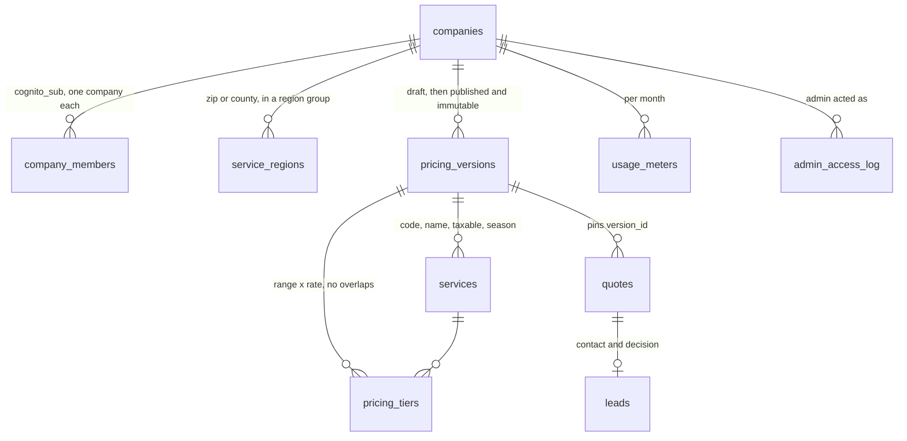

# Data model

Sixteen application tables after migration 0018 (plus `schema_migrations`, the runner's bookkeeping), one view, and the SECURITY DEFINER functions that are the public routes' entire surface. Every company-scoped table carries `company_id`, so one RLS predicate covers them all; composite foreign keys keep a child's `company_id` equal to its parent's, so a child row cannot name another company's parent. Money is integer cents. Design: [[ENGINEERING_DESIGN#7. Data model and Row Level Security|§7]]; the files: [[Migrations]]; the code around it: [[Database Package]].

## Company-scoped tables (RLS with `ENABLE` + `FORCE`)

| Table | Holds | Notable columns |
| --- | --- | --- |
| `companies` | One row per operator | `slug` (public; in the widget URL), `name`, `hic_no`, `allowed_origins[]` (empty: any site may embed), `theme` (jsonb: color, logo key), `phone` (shown to homeowners asked to call), `alert_email`, `alert_phone` (where lead alerts go), `regrid_lookup_quota` (the monthly estimate allowance; 5 on a trial; the name is historical), `service_street`, `service_city`, `service_state`, `service_zip`, `service_radius_miles` (the typed business address and radius), `questionnaire` (jsonb), `stripe_customer_id` (unused) |
| `company_members` | Cognito `sub` → company, with a role | The only way a request finds its company. One company per login |
| `service_regions` | Where the company works | `kind` (`zip` or `county`), `value`, and the region group tiers are written for. A zip region wins over a county region |
| `pricing_versions` | A company's rate tables, numbered | `version`, `min_charge_cents`, `coverage_factor` (carried, no longer read), `published_at`. Triggers raise SQLSTATE `55000` on any change once published |
| `services` | A version's services | `code`, `name`, `taxable` (R1), `season` (`growing` or `winter`); defaults from `service_catalog` |
| `pricing_tiers` | A version's prices | `service_id`, `region_group`, `min_sqft`, `max_sqft` (covers `min < sqft <= max`), one of `price_per_sqft_microcents` or `flat_price_cents`. A `btree_gist` exclusion constraint rejects overlapping ranges for the same version, service and region group |
| `quotes` | Every estimate priced | `status`, `version_id` (pinned), `address_text`, `zip`, `county`, `tax_rate`, `region_group`, `grass_sqft`, `original_grass_sqft`, `origin` (`drawn`, `bucket`, `manual`, or the retired `regrid`, `regrid_adjusted`), `line_items` (jsonb: the contract's `QuoteLine[]`), `tax_cents`, `total_cents`, `turnstile_ok`, `ip_hash` (salted), `host_origin`, `regrid_parcel_id` (text, no foreign key), `created_at` |
| `leads` | A submitted quote's contact and the operator's decision | `name`, `phone`, `email` (PII: never logged), `decision`, `adjusted_total_cents` (only on an accepted lead), `notified_at`, `sms_sent_at`. A trigger raises `LQ001` on a second decision |
| `usage_meters` | Per company per month | `regrid_lookups` (dormant), `quotes` (estimates priced this month, compared with the allowance) |
| `admin_access_log` | One row each time the `admin` group acts as a company | Written in its own transaction before the request runs; `app_rw` may insert but not read |

## Reference tables (no company)

| Table | Holds | Source |
| --- | --- | --- |
| `tax_rates` | One row per Pennsylvania county: 6%, Allegheny 7%, Philadelphia 8%. Keyed so that an unknown county is an error, never a default rate | Migration 0004, from [[COMPLIANCE_REQUIREMENTS#1. Pennsylvania sales tax on lawn care services|compliance §1]] |
| `service_catalog` | The seeded Pennsylvania service list with taxable flags per 61 Pa. Code § 55.6 | Migration 0004; no snow removal until verified (R5) |
| `zip_county` | Each Pennsylvania zip's primary county (largest land share); 1,833 zips | Census 2020 ZCTA relationship file via `scripts/gen_zip_county.py` |
| `zip_county_parts` | Every county a zip has land in | Same file, mode `parts` |
| `zip_centroid` | Each Pennsylvania zip's centre point | Census 2023 gazetteer via `scripts/gen_zip_centroid.py` |
| `parcel_cache` | Regrid parcel records, keyed by normalized address | Dormant since Regrid was retired. A cache, not a record: nothing foreign-keys into it and it can be truncated at any time (R10) |

## Roles and policies

| Role | Table access | Cross-company |
| --- | --- | --- |
| `app_rw` | Grants on the company-scoped tables, filtered by the tenant policies (`company_id = current_company_id()`) | None |
| `app_public` | No table grants at all | `SELECT` on `public_company_profile`; `EXECUTE` on the functions granted to it below |
| `app_definer` | Its own `SELECT` policies on `companies`, `company_members`, `pricing_versions`, `services`, `service_regions`, `pricing_tiers`; read and write on `quotes`, `leads`, `usage_meters`; insert on `companies`, `company_members`, `service_regions` | Owns the view and the SECURITY DEFINER functions, each of which resolves the company itself and filters on it |
| `app_owner` | Owns everything; bound by `FORCE` like any other role | Migrations only |

`current_company_id()` reads `app.company_id` and turns the empty string a pooled connection reads back into NULL, so a transaction with no company set sees zero rows rather than raising (see [[gotchas]]). The update and delete policies on the pricing tables check only the company, never `published_at`, so the immutability triggers get to fire instead of the write silently affecting zero rows.

## The view and the functions

`public_company_profile` (owned by `app_definer`): a company's id, slug, name, theme, the services of its published version and its regions. No rate, tier or contact detail.

| Function | Granted to | Does |
| --- | --- | --- |
| `company_id_for_sub(sub)` | `app_rw` | Membership lookup before `app.company_id` is set |
| `create_company_for_sub(sub, name, email)` | `app_rw` | A new login's company, membership, starting service area (every PA county, group `standard`) and trial allowance; refuses a second company |
| `county_for_zip(zip)` | `app_public`, `app_rw` | The zip's primary county, or NULL (some PO-box-only zips have no ZCTA) |
| `counties_for_zip(zip)` | `app_public`, `app_rw` | Every candidate county with its rate in basis points, primary first |
| `company_allowed_origins(slug)` | `app_public` | For the widget page's `frame-ancestors` |
| `estimate_context(…)` | `app_public` | The gate: the company, the origin allowlist (`origin_allowed`), the allowance against this month's estimates, the service, the service region |
| `estimate_pricing_input(…)` | `app_public` | Only the tiers of the one service and region group asked for (through `pricing_slice`, a helper for `app_definer`) |
| `estimate_insert_quote(slug, quote)` | `app_public` | Stores a priced quote with its pinned version and counts it |
| `estimate_quote_for_adjust`, `estimate_apply_adjustment` | `app_public` | The one-time adjustment of a parcel-based quote (retired path) |
| `submit_lead(…)` | `app_public` | Quote → lead, with the 24-hour dedupe and SMS-cap bookkeeping |
| `lead_mark_notified(slug, lead, sms)` | `app_public` | After the alert is sent |
| `regrid_reserve_lookup`, `parcel_cache_put` | `app_public` | The dormant Regrid metering and cache |
| `origin_allowed(list, origin)`, `usage_month()` | `app_definer`, `app_rw` | Helpers |

## Quote lifecycle

| Status | Set by | Meaning |
| --- | --- | --- |
| `priced` | `/estimate` | Lines, tax and total from a pinned version; the signed token lasts 7 days |
| `submitted` | `/submit` | Contact captured, lead row exists, company alerted |
| `accepted` / `declined` | The owner, `POST /leads/{id}/decision` | Once only; `adjust` accepts at the owner's own total |
| `expired` | A scheduled job (not built yet) | No action within 30 days |

Related: [[Migrations]], [[Database Package]], [[Request Flows]].
