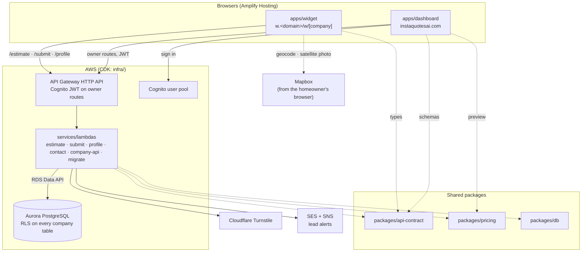

# Project structure

InstaQuotesAI is a B2B SaaS for lawn and snow operators. A company embeds a widget on its website (or shares a hosted page and a QR code); a homeowner types their address, outlines their lawn on an aerial photo of it, and gets an instant estimate from the company's own published rate table, with Pennsylvania sales tax applied per line. The design of record is [[ENGINEERING_DESIGN]]; the legal and tax requirements (R1–R31) are [[COMPLIANCE_REQUIREMENTS]].

These notes describe how the repository is laid out and how its parts fit together. Each workspace has a note; the cross-cutting ones are [[Request Flows]], [[Data Model]], [[Configuration]] and [[Testing and CI]]. [[Architecture.canvas|Architecture]] is the same picture as a canvas, and [[Glossary]] defines the words the code uses.

## The repository at a glance

```text
lawn-estimate/
├── apps/
│   ├── widget/           @lq/widget        homeowner widget, hosted page, v1.js embed script
│   └── dashboard/        @lq/dashboard     operator dashboard and the public website
├── packages/
│   ├── pricing/          @lq/pricing       the pure pricing engine (priceQuote)
│   ├── api-contract/     @lq/api-contract  zod schemas, types and the route table for every API call
│   └── db/               @lq/db            migrations, transaction entry points, drivers, RLS tests
├── services/
│   └── lambdas/          @lq/lambdas       the API handlers (AWS Lambda) and the local dev server
├── infra/                @lq/infra         AWS CDK stacks (LqState, LqApi, LqEdge) and ops scripts
├── docs/                                   this vault: design, compliance, how-tos, gotchas, structure
├── docker/initdb/                          local Postgres: creates app_owner and the database
├── .github/workflows/ci.yml                typecheck, migrations and every test on each PR
├── amplify.yml                             Amplify Hosting build for both front ends
├── docker-compose.yml                      local PostgreSQL 16 on port 54320
├── CLAUDE.md                               project instructions for coding agents
└── package.json                            npm workspaces root
```

## How the parts connect



The two Next.js apps are shells with no business logic: the widget never receives a rate, and the dashboard never touches a database. Everything that decides a price or reads a row runs in a Lambda, through the three shared packages.

| Workspace | Package | What it is | Note |
| --- | --- | --- | --- |
| `apps/widget` | `@lq/widget` | The homeowner widget at `w.<domain>/w/[company]`, the hosted page, and the `v1.js` embed script | [[Widget App]] |
| `apps/dashboard` | `@lq/dashboard` | The operator dashboard and the public website, on the company's origin | [[Dashboard App]] |
| `packages/pricing` | `@lq/pricing` | `priceQuote`: the pure, rules-only pricing engine | [[Pricing Package]] |
| `packages/api-contract` | `@lq/api-contract` | Zod schemas, inferred types and the `routes` table for every API call | [[API Contract Package]] |
| `packages/db` | `@lq/db` | Migrations, the three transaction entry points, the two drivers, the wrong-tenant suite | [[Database Package]], [[Migrations]], [[Data Model]] |
| `services/lambdas` | `@lq/lambdas` | The API handlers and the local dev server | [[Lambdas]] |
| `infra` | `@lq/infra` | CDK stacks `LqState`, `LqApi`, `LqEdge` and the operational scripts | [[Infrastructure]] |
| root | | Workspaces, Docker, CI, Amplify, agent settings | [[Repository Root]] |

## Boundaries you can see in the layout

These are the non-negotiables of `CLAUDE.md` and [[ENGINEERING_DESIGN#2. Constraints the design treats as fixed|design §2]] as they show up in the folder structure.

- **Pricing lives in one package.** `packages/pricing` is pure and runs server-side. The `/estimate` Lambda and the dashboard's quote preview call the same function; the browser only ever sees amounts.
- **The contract comes first.** A request or response shape changes in `packages/api-contract`; Lambdas validate with it, front ends use its types, and the CDK stack reads its `routes` table to build the API.
- **Three database entry points, all in `packages/db`.** `withCompany` for owner routes (as `app_rw`), `withPublic` for public routes (as `app_public`, which has no table grants), `signUp` for a new login's first company. Nothing else opens a transaction.
- **Tenancy is enforced in the database.** Row Level Security with `FORCE` on every company-scoped table, keyed on `app.company_id`, which is set from `company_members` by Cognito `sub`. The wrong-tenant test in `packages/db/test/rls.test.ts` must pass before anything merges.
- **Migrations are append-only.** `packages/db/migrations` only ever gains a file.
- **Two front-end origins.** The widget (`w.`) and the dashboard are separate Next.js apps on separate origins; the widget runs on sites we do not control, so it has its own CSP, Turnstile on every call, and no cookies.
- **Nothing from Mapbox reaches our API.** The widget geocodes and shows the satellite photo in the browser; only the outline's area in square feet and the zip the homeowner typed are sent.
- **Secrets live only in Secrets Manager and Lambda env.** Both apps' environments hold public values only; the Mapbox token must be a public `pk.` token.
- **Money is integer cents; tax rates are integer basis points.** Formatting happens only at the edge (`money.ts`, `format.ts` in each app).

## Where to go for

| To change | Go to |
| --- | --- |
| A request or response field | `packages/api-contract` first, then the Lambda, then the front end (and the dashboard's mock) |
| How a price is computed | `packages/pricing/src/index.ts` and `test/pricing.test.ts` |
| A table, a policy, a database function | A new numbered file in `packages/db/migrations`, never an edit |
| What `/estimate` checks before pricing | `services/lambdas/src/public/estimate.ts` and `estimate_context` (migrations 0009, 0013) |
| An owner route | `services/lambdas/src/company/*.ts`, then `apps/dashboard/src/mock/handlers.ts` so the mock keeps up |
| A widget screen | `apps/widget/src/components/screens.tsx` or `YardScreen.tsx`; the flow is in `Widget.tsx` |
| The embed script | `apps/widget/embed/v1.js`, and `src/lib/embed-bridge.ts` on the iframe side |
| A dashboard screen | `apps/dashboard/src/app/(app)/…/page.tsx` |
| A Lambda's environment or permissions | `infra/lib/api-stack.ts` |
| Anything that must survive a redeploy | `infra/lib/state-stack.ts`, after reading `cdk diff` |
| Local development | [[local-loop]]; deployment: [[deploy]]; surprises: [[gotchas]] |

## Build order

The code was built in the order of [[ENGINEERING_DESIGN#14. Build sequence|design §14]]: schema and RLS, the pricing package, Cognito and the dashboard shell, the estimate and submit Lambdas, the widget and `v1.js`, abuse controls and billing, then Playwright and axe. The git history maps onto those steps, and the [[ENGINEERING_DESIGN#15. Decisions and open questions|Decisions table]] records each call made along the way. One branch per build step, always created from `main`.
