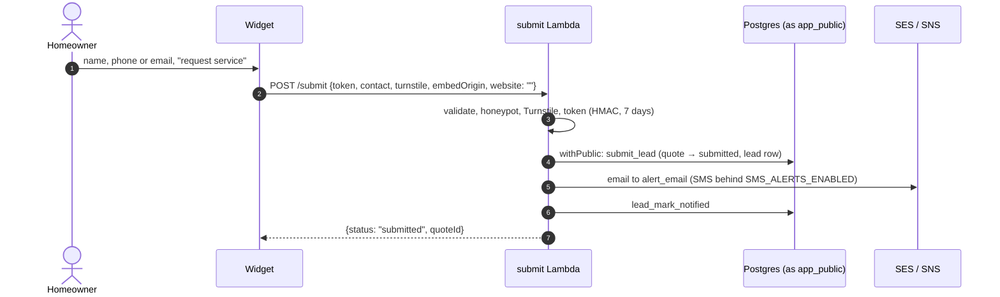
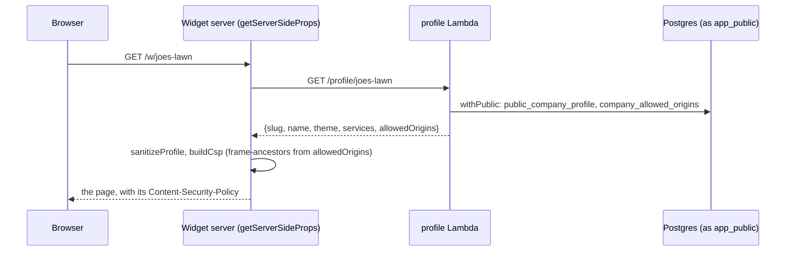

# Request flows

How a request moves through the workspaces, with the files for each hop so the diagrams can be followed into the code. Design: [[ENGINEERING_DESIGN#5. Estimate and lead flow|§5]], [[ENGINEERING_DESIGN#6. Grass estimate|§6]], [[ENGINEERING_DESIGN#9. Public routes and abuse controls|§9]].

## An estimate

```mermaid
sequenceDiagram
  autonumber
  actor H as Homeowner
  participant W as Widget (apps/widget)
  participant M as Mapbox
  participant T as Turnstile
  participant L as estimate Lambda
  participant P as Postgres (as app_public)
  H->>W: service, street, city, state, zip
  W->>M: geocode (browser, public token)
  M-->>W: position
  W->>M: static satellite image
  H->>W: outlines the lawn (positive and negative areas)
  W->>W: lawnSqft (polygon-clipping) → square feet
  W->>T: fresh token
  W->>L: POST /estimate {company, address, service, manual: {zip, size: {kind: "drawn", sqft}}, turnstile, embedOrigin}
  L->>L: validate (api-contract), verify Turnstile
  L->>P: withPublic: estimate_context (origin allowlist, allowance, service, region)
  L->>P: counties_for_zip (county_required if the rates differ)
  L->>P: estimate_pricing_input (this service and region group only)
  L->>L: priceQuote (packages/pricing)
  L->>P: estimate_insert_quote (status priced, version pinned)
  L-->>W: {status: "priced", quote, token, grassSqft, county, origin: "drawn"}
  W->>H: lines, tax, total; "measured on an aerial photo, not a survey"
```

Files: `apps/widget/src/components/Widget.tsx`, `YardScreen.tsx`, `src/lib/mapbox.ts`, `src/lib/turnstile.ts`, `src/lib/api.ts` → `services/lambdas/src/public/estimate.ts`, `public/db.ts`, `packages/pricing/src/index.ts` → migrations 0009, 0013 and 0007.

Other outcomes of the same call: `manual_required` (no automatic price; the lot-size form), `county_required` (the zip spans counties taxed differently), `call_us` (outside the service area, no tier for the size, or no county on file), and the errors `turnstile_failed`, `origin_not_allowed` and `quota_exceeded`. Nothing from Mapbox is in the request: only the area and the typed zip.

## A lead



Files: `services/lambdas/src/public/submit.ts`, `token.ts`, `notify.ts`. A contact that already sent the company a lead in the last 24 hours gets a lead row but no second alert; a filled honeypot gets a success answer and nothing is stored; a failed alert never fails the submit.

## The widget page itself



When embedded, `v1.js` on the host page and `embed-bridge.ts` in the iframe then shake hands (`lq:ready` → `lq:hello`), which is how the widget learns the embedding origin it reports as `embedOrigin`. See [[Widget App]].

## An owner request

```mermaid
sequenceDiagram
  participant D as Dashboard (browser)
  participant C as Cognito
  participant G as API Gateway (JWT authorizer)
  participant L as company-api Lambda
  participant P as Postgres (as app_rw)
  D->>C: sign in (SRP password; authenticator code if set up)
  C-->>D: ID token (sessionStorage)
  D->>G: GET /leads, Authorization: Bearer <ID token>
  G->>G: verify signature, audience, expiry
  G->>L: event with verified claims
  L->>L: claimsFrom: sub, cognito:groups
  L->>P: withCompany: company_id_for_sub(sub), set_config('app.company_id')
  L->>P: SELECT … FROM leads (RLS filters)
  L-->>D: {leads, nextCursor}, parsed with the contract
```

Files: `apps/dashboard/src/lib/auth/cognito-client.ts`, `src/lib/api.ts` → `services/lambdas/src/company/api.ts`, `company/leads.ts` → `packages/db/src/with-company.ts`. No request names a company. The `admin` group may act as one with the `x-act-as-company` header, which is audited in `admin_access_log`.

## A new account

1. `/sign-up` creates a Cognito login; Cognito emails a six-digit code and the login can do nothing until it is entered.
2. The first sign-in lands on `/onboarding`, which calls `POST /company` with a name. The token must carry a verified email.
3. That route cannot use `withCompany` (the login has no company), so it uses `signUp`: one statement, `create_company_for_sub`, which makes the company, the membership, a starting service area (every Pennsylvania county in region group `standard`) and the trial allowance of 5 estimates a month. There is no pricing, so nothing is quoted until the owner publishes a version.
4. Onboarding continues to `/settings/area` (where the company works), then `/pricing` (what it charges).

## Locally

`services/lambdas/dev/server.ts` stands in for CloudFront, API Gateway and the Cognito authorizer on port 8787: the contract's `routes` are its routing table, it adds CORS for the two front-end origins, and it passes the dashboard's unsigned mock token on as verified claims, which is why it listens on loopback only and refuses a database that is not on this machine. The handlers, `withPublic`, `withCompany`, pricing and Turnstile are real; lead alerts are composed and printed. See [[local-loop]].

Related: [[Lambdas]], [[Data Model]], [[API Contract Package]].
