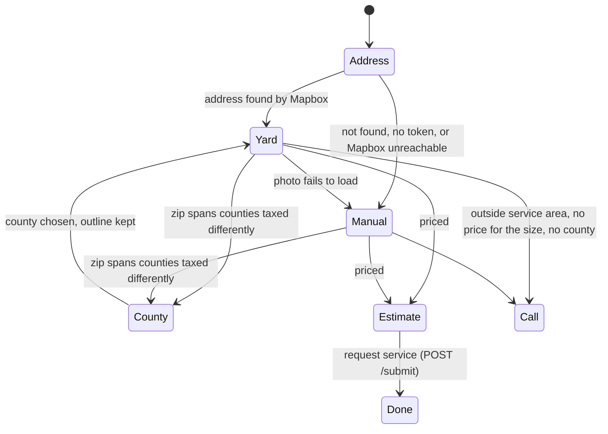

# Widget app

`apps/widget` is the homeowner-facing Next.js app at `w.<domain>`. One route, `/w/[company]`, is both the iframe a company embeds and the hosted page a company can link to or print as a QR code. The same workspace builds `v1.js`, the embed script a company pastes into its site. Design: [[ENGINEERING_DESIGN#4. Embeddable widget|§4]], [[ENGINEERING_DESIGN#5. Estimate and lead flow|§5]], [[ENGINEERING_DESIGN#6. Grass estimate|§6]], [[ENGINEERING_DESIGN#11. Accessibility (WCAG 2.2 AA)|§11]].

No pricing happens here and no secret lives here. The page is rendered on the server from the company's public profile, and the browser makes exactly three kinds of outside call: Mapbox (address lookup and the satellite photo), Cloudflare Turnstile, and our own `/estimate` and `/submit`.

## Layout

```text
apps/widget/
├── embed/v1.js                 the embed script (plain ES2017, no dependencies, ~1.3 KB minified)
├── scripts/build-embed.mjs     esbuild: embed/v1.js → public/v1.js + public/embed/<hash>.js
├── fixtures/                   recorded request/response pairs for local work without an API
│   ├── profiles.json             joes-lawn (embeddable, dark brand) and sunny-yards (hosted only)
│   └── estimate.json, submit.json, errors.json
├── src/
│   ├── pages/                    Pages Router (per-request render, per-company CSP, no inline script)
│   │   ├── _app.tsx, _document.tsx
│   │   ├── w/[company].tsx       the widget page: getServerSideProps + Content-Security-Policy
│   │   └── api/fixtures/         /estimate and /submit stand-ins when LQ_FIXTURES=1
│   ├── components/
│   │   ├── Widget.tsx            the whole flow as one in-memory state machine
│   │   ├── screens.tsx           Address, Estimate, Manual (lot size), County, Call, Done
│   │   ├── YardScreen.tsx        the aerial photo and the SVG outline editor
│   │   └── ui.tsx                buttons, fields, live regions
│   ├── lib/
│   │   ├── api.ts                createApi: POST /estimate, POST /submit; no cookies, types only from the contract
│   │   ├── embed-bridge.ts       the iframe's half of the postMessage handshake with v1.js
│   │   ├── mapbox.ts             geocode, static image URLs, projection maths, ringSqft, lawnSqft
│   │   ├── turnstile.ts          one fresh Turnstile token per public call
│   │   └── format.ts
│   ├── server/
│   │   ├── config.ts             ServerConfig, read from the environment on each request
│   │   ├── csp.ts                buildCsp, frameAncestors
│   │   ├── profile.ts            loadProfile + sanitizeProfile: company theming is validated here
│   │   └── fixtures.ts           replayEstimate / replaySubmit from fixtures/
│   ├── theme/
│   │   ├── tokens.ts             the fixed palette; a test keeps it in step with widget.css
│   │   ├── brand.ts              where a company's one color may go, contrast-checked (R25)
│   │   └── contrast.ts
│   └── styles/widget.css
├── e2e/                        Playwright + axe at 390 px: widget.spec, embed.spec, yard.spec, host-server.mjs
├── test/                       Vitest: fixtures, format, mapbox, server, theme
├── next.config.mjs             headers, canonical redirect, transpilePackages
└── playwright.config.ts
```

## How a page is served

1. `getServerSideProps` in `pages/w/[company].tsx` reads `ServerConfig` from the environment, then loads the company's profile: from `fixtures/profiles.json` when `LQ_FIXTURES=1`, otherwise `GET {LQ_API_BASE}/profile/{company}` ([[Lambdas]]). The app holds no database credentials.
2. `server/profile.ts` validates everything the company supplied before it reaches markup or a header: the color must match `#rrggbb`, the logo must be a key under our own logo CDN, the name is escaped by React.
3. `server/csp.ts` builds the page's `Content-Security-Policy`. `frame-ancestors` is the company's allowlist; an empty list (the default) is `*`, an unknown company is `'self'`. `script-src` is `'self'` plus Turnstile's origin, with no nonce and no `unsafe-inline` (the Pages Router ships no inline script). Mapbox origins are added to `img-src` and `connect-src` only when a token is configured. Brand colors reach the page as custom properties in a `style` attribute.
4. The page renders `Widget` with the sanitized brand, the allowed origins, the API base, the Turnstile site key and the Mapbox public token. A shared cache may hold the page for 60 seconds.

Routes other than `/w/*` get `frame-ancestors 'none'`. `LQ_CANONICAL_ORIGIN`, when set at build time, redirects every other host (the amplifyapp.com address) to the canonical one.

## The flow inside the browser

`Widget.tsx` holds the state; `screens.tsx` and `YardScreen.tsx` render it. Nothing is stored in cookies or storage; the only thing carried between calls is the signed quote token from `/estimate`.



- **Address** is a service picker and four labelled boxes (street, city, state, zip), joined into one line for the API. The zip is therefore always known and is what decides the tax county.
- **Yard** shows a static satellite image from `mapbox.ts` (zoom 16 to 20) and lets the homeowner place corners by tap, click or keyboard. Positive areas are grass; negative areas (house, pool) are subtracted. `lawnSqft` computes the union less the overlaps with `polygon-clipping`, in Web Mercator metres at the outline's latitude. Each view fetches two pictures: the one shown, with Mapbox's logo and credit, and a wider one behind it that a drag brings into view. Only the square feet leave the browser; no geometry does.
- **Manual** is the lot-size form: a bucket (¼, ½, 1, 2+ acres) or a typed area. It is the fallback, never offered beside a working photo.
- **Estimate** shows the lines, tax and total, labelled an estimate and "measured on an aerial photo, not a survey" (R6, R21), and the lead form.

## The embed script and the bridge

`embed/v1.js` reads `data-company`, inserts an iframe pointed at `{origin}/w/{company}` right after the script tag, keeps it as tall as its content, and listens for messages from that iframe's window at the widget origin and nowhere else. The messages are documented at the top of the file: `lq:ready` → `lq:hello` (the handshake that tells the widget which site embeds it, stamped by the browser), then `lq:meta`, `lq:resize`, `lq:focus`, `lq:submitted` (relayed to the host's `dataLayer`). `lib/embed-bridge.ts` is the iframe's half. On the hosted page every method is a no-op and the embed origin is null.

`scripts/build-embed.mjs` minifies it to `public/v1.js` (served with `max-age=3600, stale-while-revalidate=86400`) and a content-hashed copy under `public/embed/` (immutable, for hosts that pin with Subresource Integrity). `LQ_WIDGET_ORIGIN` bakes in the widget origin for production, where the script may be served from a different host than the app.

## Environment

All read on the server per request; none is secret. The full table is in [[Configuration]]. The important ones: `LQ_FIXTURES`, `LQ_API_BASE`, `LQ_TURNSTILE_SITE_KEY`, `NEXT_PUBLIC_MAPBOX_TOKEN` (must be a `pk.` token or the app refuses to start; without it every address goes to the lot-size form), `LQ_LOGO_BASE_URL`.

## Tests

- `npm test -w @lq/widget`: Vitest. Every fixture is parsed with [[API Contract Package|the contract]] and its totals re-added; the CSP builder, profile sanitizer, Mapbox maths and token/contrast pairs are covered.
- `npm run test:e2e -w @lq/widget`: Playwright against a production build on port 3101 (so the CSP under test is the one that ships), a host page on 3102 (`e2e/host-server.mjs`) for the embed tests, and a second build on 3103 with a stub Mapbox token for `yard.spec.ts`. Axe runs on every screen at 390×844. See [[Testing and CI]].

Related: [[Request Flows]], [[Lambdas]] (the other end of `/estimate` and `/submit`), [[gotchas]].
